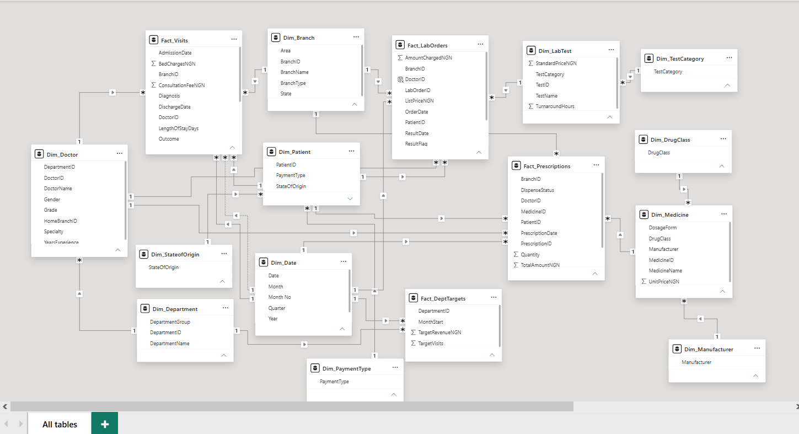
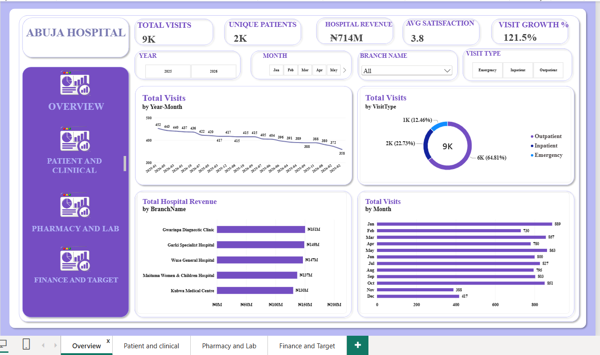
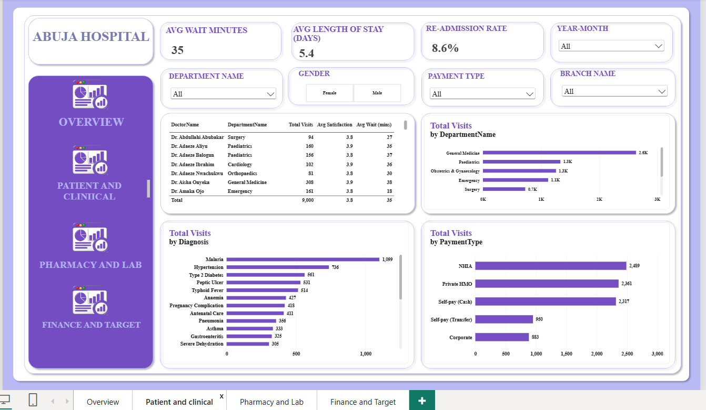
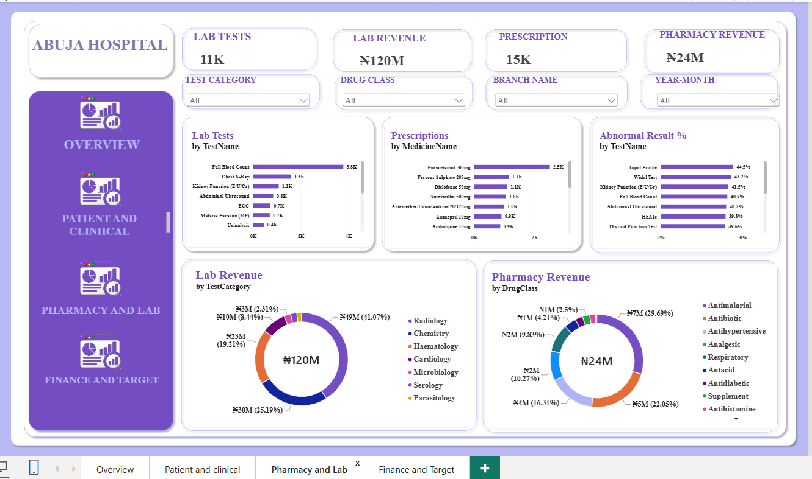
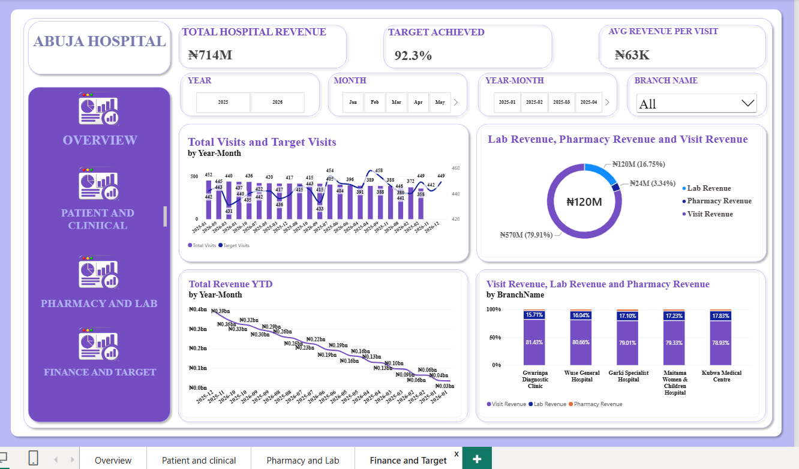

# Abuja Hospital Group: Performance Analysis Dashboard (Power BI)

## 1. Introduction

Abuja Hospital Group is a (fictional) private healthcare provider with **5 branches** across the FCT: Wuse General Hospital, Garki Specialist Hospital, Kubwa Medical Centre, Gwarinpa Diagnostic Clinic and Maitama Women & Children Hospital. The group employs 60 doctors across 8 departments and runs its own laboratories and pharmacies.

This project brings the group's visits, laboratory, pharmacy and target data into one interactive **Power BI** dashboard. It covers **January 2025 to October 2026**: 9,000 patient visits, about 11,300 lab tests and about 14,500 prescriptions.

## 2. Problem Statement

Each branch reported its numbers in separate Excel files, so management could not see performance across the whole group. At the last board meeting three concerns were raised:

1. **Growth:** Are patient numbers growing, and where?
2. **Revenue:** Which branches, services and departments bring in the money?
3. **Targets:** Are departments meeting their monthly visit targets, or are the targets unrealistic?

**Goal:** build a single dashboard that answers these questions and gives management clear recommendations for the 2027 budget.

Key business questions:

- How many visits and patients did we have, and is the number growing?
- What are the most common diagnoses, and which departments are busiest?
- How long do patients wait, how long do inpatients stay, and how many are readmitted?
- Which lab tests and medicines are in highest demand, and which earn the most?
- Where does revenue come from, and are departments hitting their targets?

## 3. Data Sourcing

The dataset is **synthetic (generated for practice)**, built to reflect a realistic Nigerian hospital setting: local branch names, common diagnoses such as malaria and typhoid, NHIA/HMO payment types and prices in Naira (₦). It contains no real patient information.

The data came as one Excel workbook with **10 sheets**:

| Table | Type | Rows | Description |
| --- | --- | --- | --- |
| Fact_Visits | Fact | 9,000 | One row per visit: admission/discharge dates, visit type, diagnosis, fees, length of stay, wait time, satisfaction |
| Fact_LabOrders | Fact | ~11,300 | One row per lab test: test, status, result flag, amount charged |
| Fact_Prescriptions | Fact | ~14,500 | One row per drug prescribed: quantity, amount, dispense status |
| Fact_DeptTargets | Fact | 192 | Monthly visit and revenue targets per department |
| Dim_Patient | Dimension | 1,800 | Gender, date of birth, state of origin, payment type |
| Dim_Doctor | Dimension | 60 | Name, specialty, grade, experience, department |
| Dim_Department | Dimension | 8 | Department name and group |
| Dim_Branch | Dimension | 5 | Branch name, area and type |
| Dim_LabTest | Dimension | 16 | Test name, category, price, turnaround hours |
| Dim_Medicine | Dimension | 18 | Drug name, class, dosage form, unit price, manufacturer |

## 4. Tools Used

| Tool | What it was used for |
| --- | --- |
| **Microsoft Excel** | Storing the raw data and first look at the tables |
| **Power Query (Power BI)** | Loading the data, checking and fixing data types, creating new dimension tables (snowflakes) |
| **Power BI Model view** | Building relationships between fact and dimension tables (star/snowflake schema) |
| **DAX** | Creating the date table, measures (KPIs, time intelligence, targets) and calculated columns |
| **Power BI Report view** | Designing the 4-page interactive dashboard with slicers and page navigation |
| **GitHub** | Hosting the project files and documentation |

## 5. Data Transformation and Cleaning

The data was already clean (no duplicate keys, no missing IDs), so the work focused on preparing it for modelling:

- **Data types:** converted all date columns (AdmissionDate, DischargeDate, OrderDate, ResultDate, PrescriptionDate, MonthStart) from Date/Time to **Date** so they match the calendar table.
- **Checked keys:** confirmed every ID (PatientID, DoctorID, BranchID, TestID, MedicineID) is unique in its dimension table.
- **Expected blanks:** ResultDate is empty only for lab tests that are Pending or Cancelled. These were kept, not removed.
- **New dimension tables:** created **Dim_TestCategory, Dim_DrugClass, Dim_Manufacturer, Dim_StateofOrigin** and **Dim_PaymentType** in Power Query (Reference → Remove Other Columns → Remove Duplicates).
- **Calendar table:** created **Dim_Date** with DAX (1 Jan 2025 – 31 Dec 2026) with Year, Quarter, Month, Month No and Year-Month columns. Marked it as a date table and sorted Month by Month No.
- **DoctorID on lab orders:** added DoctorID to Fact_LabOrders so lab tests can also be analysed by doctor and department.
- **Auto-detect relationships and Auto date/time turned off**, so every relationship was built and checked manually.

## 6. Data Modelling

The model is a **starflake (galaxy) schema**: four fact tables share common dimensions, with some dimensions split into snowflakes.

**Star part:** each fact table links directly to its dimensions.

| Fact table | Dimensions linked directly |
| --- | --- |
| Fact_Visits | Dim_Patient, Dim_Doctor, Dim_Branch, Dim_Date |
| Fact_LabOrders | Dim_Patient, Dim_Branch, Dim_LabTest, Dim_Date |
| Fact_Prescriptions | Dim_Patient, Dim_Doctor, Dim_Branch, Dim_Medicine, Dim_Date |
| Fact_DeptTargets | Dim_Department, Dim_Date |

**Snowflake part:** some dimensions link through another dimension.

| Outer dimension | Links to | Reaches |
| --- | --- | --- |
| Dim_Department | Dim_Doctor | Fact_Visits, Fact_Prescriptions |
| Dim_TestCategory | Dim_LabTest | Fact_LabOrders |
| Dim_DrugClass, Dim_Manufacturer | Dim_Medicine | Fact_Prescriptions |
| Dim_StateofOrigin, Dim_PaymentType | Dim_Patient | Visits, Lab orders, Prescriptions |

**Key modelling decisions:**

- All relationships are **one-to-many, single direction**, from dimension to fact.
- **Role-playing date:** Dim_Date has an **active** relationship to AdmissionDate and an **inactive** (dotted) one to DischargeDate, used with `USERELATIONSHIP` when needed.
- **No fact-to-fact relationships.** Facts are compared through shared dimensions (Date, Branch, Patient).
- **Mixed granularity:** targets are monthly per department, while visits are daily per doctor. Both connect to the same Dim_Date and Dim_Department, so actuals and targets can be compared at month level.
- Measures are kept in separate **measure tables** (Visit_Dax, Time_Dax, Lab and Pharmacy Dax, Target_Dax).

## 7. Analytics and DAX Measures

| Measure table | Measure | DAX | Purpose |
| --- | --- | --- | --- |
| Visit_Dax | Total Visits | `COUNTROWS ( Fact_Visits )` | Number of visits |
| Visit_Dax | Unique Patients | `DISTINCTCOUNT ( Fact_Visits[PatientID] )` | Different patients seen |
| Visit_Dax | Visit Revenue | `SUM ( Fact_Visits[ConsultationFeeNGN] ) + SUM ( Fact_Visits[BedChargesNGN] )` | Consultation + bed income |
| Visit_Dax | Avg Satisfaction | `AVERAGE ( Fact_Visits[SatisfactionScore] )` | Patient rating (1–5) |
| Visit_Dax | Avg Wait (mins) | `AVERAGE ( Fact_Visits[WaitTimeMinutes] )` | Average waiting time |
| Visit_Dax | Avg Length of Stay | `CALCULATE ( AVERAGE ( Fact_Visits[LengthOfStayDays] ), Fact_Visits[VisitType] = "Inpatient" )` | Days in hospital (inpatients) |
| Visit_Dax | Readmission Rate % | `DIVIDE ( CALCULATE ( [Total Visits], Fact_Visits[Readmitted30Days] = "Yes" ), CALCULATE ( [Total Visits], Fact_Visits[VisitType] = "Inpatient" ) )` | Inpatients readmitted within 30 days |
| Visit_Dax | Discharges | `CALCULATE ( [Total Visits], USERELATIONSHIP ( Dim_Date[Date], Fact_Visits[DischargeDate] ) )` | Visits counted by discharge date |
| Time_Dax | Visits Last Year | `CALCULATE ( [Total Visits], SAMEPERIODLASTYEAR ( Dim_Date[Date] ) )` | Same period, previous year |
| Time_Dax | Visits Growth % | `DIVIDE ( [Total Visits] - [Visits Last Year], [Visits Last Year] )` | Year-on-year growth |
| Time_Dax | Total Revenue YTD | `TOTALYTD ( [Total Hospital Revenue], Dim_Date[Date] )` | Running revenue total for the year |
| Lab and Pharmacy Dax | Lab Tests | `COUNTROWS ( Fact_LabOrders )` | Number of lab tests |
| Lab and Pharmacy Dax | Lab Revenue | `SUM ( Fact_LabOrders[AmountChargedNGN] )` | Lab income |
| Lab and Pharmacy Dax | Abnormal Result % | `DIVIDE ( CALCULATE ( [Lab Tests], Fact_LabOrders[ResultFlag] = "Abnormal" ), CALCULATE ( [Lab Tests], Fact_LabOrders[Status] = "Completed" ) )` | Share of results that found a problem |
| Lab and Pharmacy Dax | Prescriptions | `COUNTROWS ( Fact_Prescriptions )` | Number of drugs prescribed |
| Lab and Pharmacy Dax | Pharmacy Revenue | `CALCULATE ( SUM ( Fact_Prescriptions[TotalAmountNGN] ), Fact_Prescriptions[DispenseStatus] = "Dispensed" )` | Income from dispensed drugs |
| Lab and Pharmacy Dax | Total Hospital Revenue | `[Visit Revenue] + [Lab Revenue] + [Pharmacy Revenue]` | All income combined |
| Target_Dax | Target Visits | `SUM ( Fact_DeptTargets[TargetVisits] )` | Planned visits |
| Target_Dax | Target Achieved % | `DIVIDE ( [Total Visits], [Target Visits] )` | Actual vs target visits |
| Target_Dax | Avg Revenue per Visit | `DIVIDE ( [Visit Revenue], [Total Visits] )` | Income per visit |

**Headline results (Jan 2025 – Oct 2026):**

| KPI | Result |
| --- | --- |
| Total visits | 9,000 |
| Unique patients | ~1,800 |
| Total hospital revenue | ₦714M |
| Average revenue per visit | ₦63K |
| Average satisfaction | 3.8 / 5 |
| Average wait time | 35 minutes |
| Average length of stay | 5.4 days |
| Readmission rate | 8.6% |
| Target achieved | 92.3% |

## 8. Dashboard and Visuals

The report has **4 pages**, linked by a navigation menu on the left. Every page has slicers (Year, Month or Year-Month, Branch) so users can filter the whole page.

### Page 1: Overview (overall hospital performance)

The executive summary for the Managing Director.

- **Cards:** Total Visits, Unique Patients, Hospital Revenue, Avg Satisfaction, Visit Growth %
- **Slicers:** Year, Month, Branch Name, Visit Type
- **Visuals:** visits trend by year-month, visit-type split (Outpatient 64.8%, Inpatient 22.7%, Emergency 12.5%), revenue by branch, visits by month

**Shows:** how busy the hospital is, which branch earns the most (Gwarinpa ₦151M, Kubwa lowest at ₦130M), and that outpatients make up two-thirds of visits.

### Page 2: Patient and Clinical (patients and quality of care)

For the Medical Director and department heads.

- **Cards:** Avg Wait Minutes (35), Avg Length of Stay (5.4 days), Readmission Rate (8.6%)
- **Slicers:** Year-Month, Department, Gender, Payment Type, Branch
- **Visuals:** doctor performance table (visits, satisfaction, wait time), visits by department, visits by diagnosis, visits by payment type

**Shows:** malaria is the top diagnosis (1,099 visits), followed by hypertension and type 2 diabetes. General Medicine is the busiest department (2.6K visits). NHIA is the most common payment type, closely followed by private HMOs and cash.

### Page 3: Pharmacy and Lab (diagnostic and drug demand)

For the laboratory and pharmacy heads.

- **Cards:** Lab Tests (11K), Lab Revenue (₦120M), Prescriptions (15K), Pharmacy Revenue (₦24M)
- **Slicers:** Test Category, Drug Class, Branch, Year-Month
- **Visuals:** lab tests by test name, prescriptions by medicine, abnormal result % by test, lab revenue by test category, pharmacy revenue by drug class

**Shows:** Full Blood Count is the most requested test (3.8K). Radiology earns 41% of lab revenue. Lipid Profile has the highest abnormal rate (44.5%). Paracetamol is the most prescribed drug, and antimalarials earn the most pharmacy revenue (29.7%).

### Page 4: Finance and Target (revenue and goals)

For the Finance Director.

- **Cards:** Total Hospital Revenue (₦714M), Target Achieved (92.3%), Avg Revenue per Visit (₦63K)
- **Slicers:** Year, Month, Year-Month, Branch
- **Visuals:** total visits vs target visits by month, revenue mix (visits / lab / pharmacy), revenue YTD trend, revenue mix by branch

**Shows:** visits make up about 80% of revenue, lab 17% and pharmacy only 3%. Departments reach about 92% of target and fall below it in most months.

## 9. Recommendations

1. **Grow inpatient and specialist services.** Inpatients are about a quarter of visits but earn about three-quarters of visit revenue, mostly from bed charges.
2. **Boost patient numbers at Kubwa Medical Centre** through community outreach and HMO/corporate partnerships. It has the fewest visits and the lowest revenue (₦130M vs ₦151M at Gwarinpa).
3. **Cut outpatient waiting time** with appointment slots and extra triage staff at peak hours. Outpatients wait far longer than emergency and inpatient patients.
4. **Set up chronic-disease clinics** for hypertension and diabetes. They are among the top diagnoses and create regular repeat visits, lab tests and prescriptions.
5. **Grow pharmacy revenue** (only 3% of the total) by dispensing at the point of consultation and reminding patients to collect their prescriptions.
6. **Promote high-value lab services** such as radiology, and review cancelled lab orders.
7. **Reset 2027 targets** based on actual 2025–2026 trends. Every department misses target by a similar 6–9%, which suggests the targets are set too high rather than one department underperforming.

## 10. Conclusion

This project turned four separate data sources into one connected Power BI model and a 4-page interactive dashboard. Management can now see visits, quality of care, lab and pharmacy activity, revenue and targets in one place, filtered by branch, department and time period.

The analysis shows a stable but **flat-growing** hospital group that depends heavily on **inpatient revenue**, with clear opportunities in **Kubwa branch growth**, **shorter outpatient waits**, **chronic-disease care**, **pharmacy sales** and **more realistic targets**.

**Skills demonstrated:** data modelling (star, snowflake and galaxy schemas), role-playing dates, mixed-granularity modelling, Power Query, DAX (CALCULATE, time intelligence, USERELATIONSHIP), dashboard design and business storytelling.

---

*Author: Nwogbe Onyinyechi Victoria, Data Analyst*
*Note: the dataset is synthetic and created for learning and portfolio purposes.*
